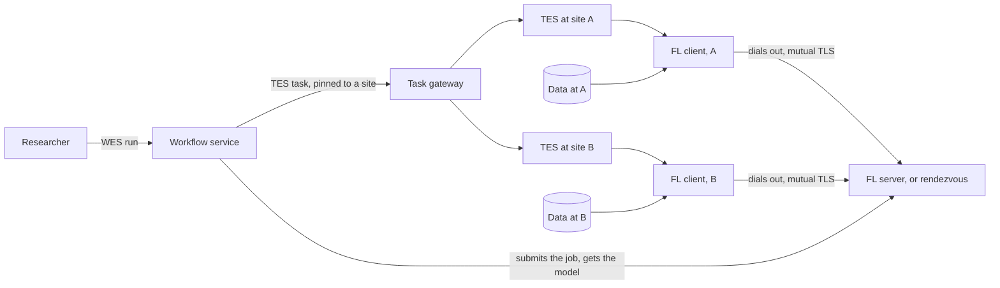

# Design

The end state, if all software followed the standards and nothing stood in the way. No constraints and no specific deployment here: those start at [Testbed](../testbed/index.md).

## Overview

The researcher talks to a workflow service. It treats a federated job like any other workflow, and asks each institution's task service for what it needs. Institutions admit a federated task like any other, with their own policy, and their data stays with them. Participants find each other through a rendezvous service that needs no inbound access to any institution.

## Identity and credentials

- Researchers sign in once; their identity travels with the run, and every institution can check it ([R-S1](requirements.md#security)).
- Each institution generates its participant's private key and never hands it over; a signing request gets it a certificate for one job ([R-S4, R-S6](requirements.md#security)). Task services have a way to hand secrets to tasks that keeps them out of task records.

## Scheduling participants

- [TES](https://github.com/ga4gh/task-execution-schemas) knows about participants that serve others: a task can ask for a reachable, named endpoint, and states how long it may run. If that exists, the server can be a task like any other.
- A task can be pinned to a site by a property of the site, or of the data it needs, and not by the address of a service. A registry, such as the [GA4GH Service Registry](https://github.com/ga4gh-discovery/ga4gh-service-registry), says which services exist.

## Data

- Data is referenced by an identifier that resolves only at the institution, as with [DRS](https://github.com/ga4gh/data-repository-service-schemas), and never passes through the workflow service ([R-P1, R-P2](requirements.md#privacy)).

## Job definitions

- Job definitions are versioned and signed, and come from a tool registry, such as [TRS](https://github.com/ga4gh/tool-registry-service-schemas), so that an institution can review and pin what it admits ([R-S5](requirements.md#security), [R-U5](requirements.md#user)).
- [WES](https://github.com/ga4gh/workflow-execution-service-schemas) has a registered workflow type for it.

## Privacy controls

- Institutions apply filters to what leaves them, such as differential privacy or secure aggregation, as they see fit, independent of the job ([R-P3](requirements.md#privacy)).

## Attribution

- The workflow service records who started what; the task services and the FL server record what ran where, under the same identifier of the run ([R-U3](requirements.md#user), [R-P4](requirements.md#privacy)).
