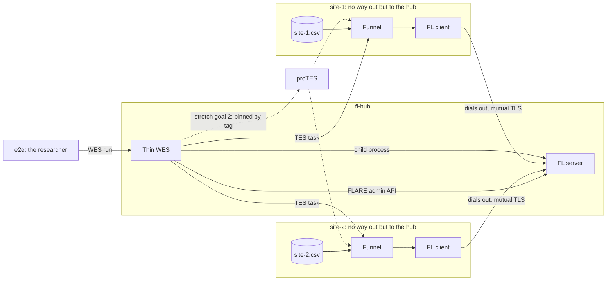

# Testbed design

The design of [B1](options.md#b1-server-beside-the-wes), the recommended option, with the WES calling the TES of each site directly. The dashed path through proTES is [stretch goal 2](index.md#goals). Compared to the [ideal design](../background/design.md), it has a hub in place of a rendezvous service, and credentials made centrally. All that's listed under [Shortcuts and hacks](shortcuts.md).



## One run

1. **Request:** `POST /ga4gh/wes/v1/runs`, with a bearer token from the trusted OIDC issuer (`WES_OIDC_ISSUER`), and `workflow_type=NVFLARE`, `workflow_url=logreg-fedavg`, and optional `workflow_params` naming the sites.
2. **Federation:** the WES writes a `project_profile.yaml`, and runs `nvflare cert init`: a new root CA for this run alone. It then provisions the server and an admin itself, through `nvflare cert request`, `approve` and `package` run locally, one after another, the admin named after the caller's validated identity (its token's `sub`).
3. **Server:** the WES starts it as a child process, and waits for its admin port.
4. **Clients:** per site, the WES submits a TES task with one input, the data, by a URL that only resolves at the site, and a one-time link to sign a certificate (`/sites/{token}/csr`). The task goes straight to the TES of the site. Only through proTES (`TES_GATEWAY_URL` set), the tag `gateway.backends` pins it there.
5. **Join:** Funnel fetches the data, and starts the image. The client makes its own key, sends the WES a signing request over its one-time link, and finishes provisioning itself with the certificate that comes back, checking the CA's fingerprint out of band first. It then dials out to `fl-hub:8002`, and blocks. The WES waits until all sites are registered, or a task has ended early.
6. **Job:** the WES submits the job through the FLARE admin API, and waits for it, watching the tasks meanwhile.
7. **End:** the WES downloads the global model, and shuts the federation down through the admin API, so that the client processes exit and the tasks end as `COMPLETE`. It deletes the run's CA and any signing slot not already used.

The run is `COMPLETE` if the job finished, and there's a model, and all tasks are `COMPLETE`. It's `SYSTEM_ERROR` if anything failed, and all remaining tasks are canceled.

## Files

```text
wes/app.py                 thin WES
images/                    images, and the wrappers for the participants
testset/                   data, job, comparison with local models
compose.yaml               the testbed: hub, two sites, tests
compose.protes.yaml        override: through proTES (T4)
compose.server-task.yaml   override: server as a TES task (T5)
compose.hub.yaml           the hub alone, for a machine with a public address
compose/                   configs of Funnel, proTES and the hub's reverse proxy
tests/                     e2e (T2, T4, T5, T7), probe (T3), site loss (T6), image contents, node probe
```
